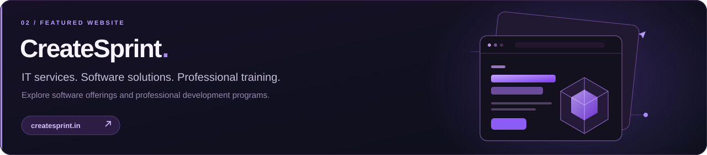
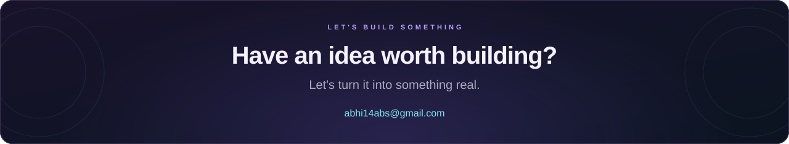

<div align="center">



<br />

[](https://abhi14abs.github.io/portfolio.github.io/)
[](https://www.linkedin.com/in/abhishek-singh-5a4400224)
[](mailto:abhi14abs@gmail.com)

**PHP & Laravel at the core. Thoughtful experiences at every layer.**

</div>

<br />

## `01` &nbsp; The developer behind the screen

I'm **Abhishek Singh**, a full stack web developer who enjoys taking an idea all the way from its first interface to the application behind it. I build with **PHP, Laravel, MySQL, JavaScript, and Tailwind CSS**, focusing on web applications that are useful, responsive, and easy to use.

```php
<?php

$abhishek = [
    'craft'     => 'Full stack web development',
    'core'      => ['PHP', 'Laravel', 'MySQL', 'JavaScript', 'Tailwind CSS'],
    'exploring' => ['Advanced Laravel', 'GitHub workflows', 'System architecture'],
    'open_to'   => ['Laravel / PHP open source', 'Meaningful web projects'],
    'mindset'   => 'Stay curious. Build thoughtfully. Keep improving.',
];
```

<br />

## `02` &nbsp; Selected work, out in the world

Three websites from my project collection. **Click a card to explore.**

<a href="https://pixpassvisa.com"></a>

<a href="https://createsprint.in"></a>

<a href="https://postryx.in"></a>

<br />

## `03` &nbsp; The tools behind the work

**Backend & data**


**Frontend & interfaces**


**Workflow & design**


<br />

## `04` &nbsp; Always building. Always learning.

| What I'm focusing on | Why it matters to me |
| :--- | :--- |
| **Deeper Laravel knowledge** | Build clearer application logic and make better use of the framework. |
| **GitHub workflows** | Make collaboration and everyday development more dependable. |
| **System architecture** | Understand how applications fit together and evolve as they grow. |
| **Open-source collaboration** | Learn with other developers and contribute to Laravel/PHP projects. |

[](https://github.com/abhi14abs?tab=repositories)
[](https://github.com/abhi14abs)

<br />

<div align="center">



<br />

[](mailto:abhi14abs@gmail.com)
[](https://www.linkedin.com/in/abhishek-singh-5a4400224)
[](https://twitter.com/unsaidsayss)
[](https://instagram.com/theeabhisingh)

[HackerRank](https://www.hackerrank.com/abhi14abs) &nbsp; / &nbsp; [GeeksforGeeks](https://auth.geeksforgeeks.org/user/abhi10vf4) &nbsp; / &nbsp; [Portfolio](https://abhi14abs.github.io/portfolio.github.io/)

<br />

<sub>Designed with intent. Built with curiosity. &nbsp; ✦ &nbsp; Abhishek Singh</sub>

</div>
